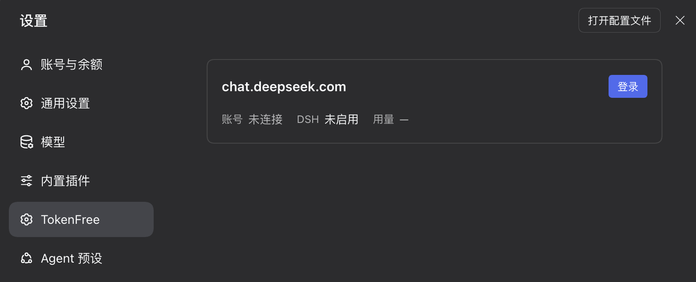
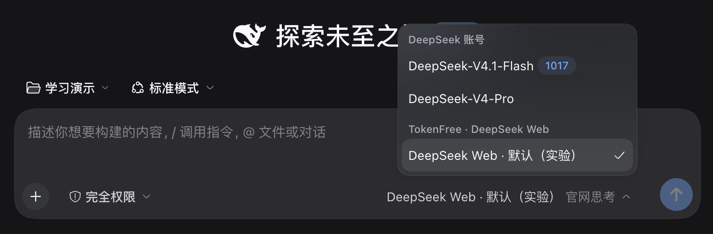

# TokenFree

> 为穷学生带来免费的 DSH

A local DSH plugin for students. No paid API key required.

TokenFree 为预算有限的学生而做，[DeepSeek Harness（DSH）](https://github.com/deepseek-ai/deepseek-harness) 能在工作目录中调用工具、读写文件并推进任务。如果确实囊中羞涩，TokenFree 把 DSH 接到你自己的 DeepSeek 网页账号上，让这些能力帮助你进行日常学习和研究。

## 当前进展

**项目正在开发中，尚无可安装的公开插件版本。**

| 阶段 | 状态 |
| --- | --- |
| 登录与对话 | 桌面、CLI、本机 Web 的登录共享、普通对话和文件工具已有实机验证。 |
| 多会话 | 桌面双会话的同时生成、独立停止、上下文与用量隔离已验证。 |
| 长对话 | 手动压缩、重启和压缩后续聊已验证；自动压缩与更多并发场景仍在完善。 |
| 公开发布 | GitHub 展示仓库已建立；npm 当前仅有 `0.0.0-stage` 暂存占位，实际开发包尚未批准公开。 |

目前的开发验证基线是 **macOS + DSH 0.2.1-rc.2**。源码与可安装版本将随发布进度提供。

[查看发布页](https://github.com/yuezengwu/dsh-tokenfree/releases) · [查看 npm 状态](https://www.npmjs.com/package/dsh-tokenfree)

## 入门教程

- [ ] **TODO：使用示例**
- [ ] **TODO：安装教学**

### 登录配置

### 选择模型

## 常见问题

### “免费”具体指什么？

TokenFree 采用 MIT 协议，插件本身不收费。它使用你自己的 DeepSeek 网页账号，无需购买付费 API Key 或 API 额度。账号要求、服务可用性与使用限制以 [DeepSeek 官网](https://chat.deepseek.com/)为准。

### 我的数据会去哪里？

模型在 DeepSeek 服务器上运行。对话中发送的问题、相关文件内容和工具结果，会通过你的账号发送到 DeepSeek 网页服务。插件的登录凭据与诊断日志保存在本机；日志可能包含任务内容。

### 这是 DeepSeek 官方项目吗？

这是社区独立维护的非官方插件，与 DeepSeek 官方没有隶属或背书关系。DSH 与 DeepSeek 网页服务分别由其上游项目维护。

### 现在能直接安装 npm 上的包吗？

`0.0.0-stage` 是 npm 暂存流程生成的占位版本，不包含可用插件。安装说明会随首个可安装版本提供。

### Windows 和 Linux 呢？

当前验证聚焦 macOS。Windows、Linux 的支持状态将在完成验证后更新。

## 一起把门槛再降一点

欢迎通过 [Issues](https://github.com/yuezengwu/dsh-tokenfree/issues) 反馈你在学习和研究中的需求，或帮助完善文档、测试与兼容性。使用示例和安装教学目前保留为 TODO。

反馈问题时，请使用不含账号凭据、私人文件或完整对话日志的最小复现。

## 致谢与许可

感谢 [DeepSeek Harness](https://github.com/deepseek-ai/deepseek-harness) 提供原生 Agent 与工具能力。

本项目采用 [MIT License](LICENSE)。第三方项目与服务保留各自的许可和使用条款。
