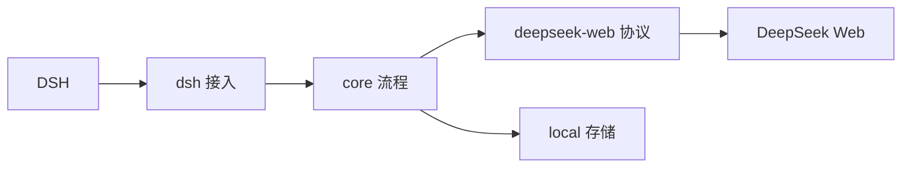

# TokenFree 技术方案

2026-10-31 main rc.5 兼容：官方源码固定 `b830ec950faba0a46dda564be3e2d854afed94f1`，新增 rc.5，保留 rc.3 / rc.4 / alpha.2。独立 rc.5 SDK 冻结安装、类型、129 项检查及实际包检查通过；同一 alpha.2 构建 tarball 在固定 rc.5 的隔离 web 组合与 headless 原生压缩挂载通过，零网络 / 模型调用。当前提交及 main CI、不可变安装随 PR 保存。无业务源码变更，旧 npm 0.2.0 仍仅支持 rc.3，未发布新版本或标签，也不补充真实账号或自然 50% 验收。详见[兼容约定](COMPATIBILITY.md)。


2026-10-23。本文是唯一的当前技术主方案，对应 [产品规格](PRODUCT_SPEC.md) 和 [规格汇总](SPEC_STATUS.md)。当前交付范围见 [主链实现](MAIN_CHAIN.md) 和 [计量与压缩](COMPACTION.md)。多会话并发已按本方案实施；源码、本地验证与官网真实验收分别记录。

最新决策恢复专用 Chrome 资料与官方登录窗口，通过调试管道控制，不新增监听端口；不安装扩展、不读取日常 Chrome 数据。凭据共享、退出和验证边界见[专用窗口登录](BROWSER_CONNECTION.md)。

同一登录账号下，不同 DSH session 必须独立并发，不设置账号生成队列。运行时代码使用会话级锁和活动状态；官网真实并发与完整首发验收仍以验证记录为准。

本次整体 Review 继续保持一个 npm 包、四组模块。并发是原有会话边界的修正，不增加调度器、账号请求队列、全局恢复协调器或新的状态层。Review 结果见 [技术复核](TECHNICAL_REVIEW.md)。

最新边界收敛：压缩是 TokenFree 接入的内置行为，随登录可用且会话选中 TokenFree 一起生效。官网计量触发、DSH 原生摘要/checkpoint 和网页新 chat 承接必须成套接入，不再要求用户单独装配压缩后端。下文以“压缩接入边界”为准；此前要求逐 profile/preset 选择 `dsh-tokenfree/compaction` 的步骤撤回。2026-10-23 已通过主插件接入原生 Basic 作用域，标准模式自动接线及最少状态已实现；离线组合与真实验收范围分别见 [验证记录](VALIDATION.md)。

最新计量策略（2026-10-23）：主动门槛改为有效预算 B 的 50%，`C ≥ ceil(B/2)`。B 优先使用官网当前模型/思考模式的有效预算；读不到时使用用户指定默认值 **890,880 tokens**，默认门槛 **445,440 tokens**。默认来源单独记录，不冒充官网实时返回。C 始终来自当前分支官网计数，缺 C 不估算、不触发。这项决策取代旧 80% 与“缺 B 禁用判断”的规则；历史验收按原比例保留。

## 1. 一个包，四组模块

一个 npm 包 `dsh-tokenfree`，主机、CLI 和客户端产物一起发布，不拆子包、不增加常驻服务或监听端口。



| 模块 | 职责 | 不承担的职责 |
| --- | --- | --- |
| `dsh/` | LlmAdapter、公开事件、schema 包装、压缩扩展、owner Remote、UI 与 CLI 接入 | 不解析 SSE，不拼 prompt，不维护第二套生成状态机 |
| `core/` | 用途分流、上下文增量、工具文本协议、操作状态机、官网压缩门槛 | 不导入 DSH、Cordis 或 React，不执行工具 |
| `deepseek-web/` | 登录官网交互、HTTP/PoW、SSE、官网配置、消息树及原生操作 | 不理解 DSH session、工具 schema 或 checkpoint，不决定业务重试 |
| `local/` | 私有文件、原子保存、锁、撤销和追加日志 | 不解析官网协议，不决定生成或压缩策略 |

依赖方向固定为 `dsh → core → deepseek-web/local`。桌面和 Web 通过 DSH 已有 owner Remote 访问主机，headless CLI 使用同一适配器与本地状态，不依赖 SessionController、API gateway 或新增服务；凭据不进入客户端。仅为传输、存储、时钟和原生 schema 校验保留必要注入点，不建设通用 Provider、事件总线或事务框架。

### 能力归属

| 类别 | 能力 |
| --- | --- |
| 直接继承 DSH | Agent 循环、同一会话内的排队/打断、跨会话任务并发、工具审批与执行、真实工具结果、历史与分叉、原生渲染、压缩事务与 checkpoint、本地标题 fallback |
| TokenFree 适配或局部替换 | 网页协议转原生块；系统/工具文本桥接；仅 TokenFree 路由的官网 50% 压缩判断及候选范围计算；搜索排除 |
| TokenFree 新增 | 本人官网登录、三端共享撤销、网页关联、增量前缀检查、恢复与停止核实、官网指标展示、本地诊断、JSON/schema 和可见文本 stop 补偿 |

DSH 决定任务与执行权限；官网决定生成、消息树、终态和原始计数；插件负责适配与关联。文本协议不是官网原生 function calling，不能替代 DSH 授权。插件不读取或改写 DSH 内部数据库。

## 2. P1-1：原生启用、默认模型与分叉

**采用现有行为：**用户已明确接受启用 TokenFree 时更新全局默认，取消此前“只影响当前会话”的限制。原兼容基线为 DSH `0.2.1-rc.3`；2026-10-30 main 额外验证 rc.4 / alpha.2，未升级个人宿主，边界见[兼容约定](COMPATIBILITY.md)。不需要上游新增接口或 saveDefault 参数。

桌面和 Web 登录后提供“使用 TokenFree”入口，说明“同时设为默认模型”，不增加确认弹窗。CLI 沿用原生配置启动，路由始终固定为 TokenFree / `web-default`：

| 场景 | 公开接线 |
| --- | --- |
| 有当前会话 | 调 `sessionController.selectModel({ sessionId, provider, model, reasoningEffort })`；DSH 更新原生选择记录与缓存，并后台保存全局默认 |
| 设置页无当前会话 | 主机用 `llm.resolveCallConfig` 验证固定路由，再调并等待 `agentDefaultModel.saveSelection`；不伪造 session、不批量改已有会话 |
| headless CLI | 以 TokenFree 作为该 profile/显式 overlay 的原生 agent-default-model；由 headless 自己读取默认、安装 ModelSelectionRef 并创建/恢复 Agent，插件不重复安装选择器 |
| 独立 tokenfree 登录/诊断 CLI | 只操作共用账号与诊断，不直接调用另一 DSH 进程的服务，不修改 DSH 私有配置或后台定位“当前会话” |
| 已启用会话重启 | 直接读取 DSH 原生持久选择；不因打开页面或重试登录反复覆盖用户默认 |
| TokenFree 会话产生新的普通分叉 | 在公开、串行等待的 `agent/created` 中，识别新建 seeded session 及 parentSession，读取父会话原生有效选择与附加设置，调用同一公开 selectModel 选中子会话并等待返回，再允许首轮组装 |

分叉接线只在具备 SessionController 的主机上处理 TokenFree 父会话的新建普通分叉，不覆盖其他模型会话、subagent 或既有 session 的 resume。父子只有启用与设置继承，不共享网页 chat、游标、active 或工具派发；仅查看不创建网页 chat。选择失败则初始化失败，不能先向全局默认发一轮再修正。当前源码在 agent/created 前已注册 live Agent，公开 selectModel 能解析该实例；事件等待先于输入处理，实际次序仍须组合验收。headless 沿用其入口自己的选择与恢复规则，不为它加载桌面 controller。

“全局”指当前 DSH 配置/profile 的默认，新会话按原生规则使用；已经有原生选择的其他会话不批量迁移。忙时选择按 DSH 原生边界生效，不热改在途请求。插件不再安装第二套选择钩子、不直接追加原生选择事件、不访问 controller 私有缓存，也不备份后自动恢复全局默认。

默认保存失败只影响该次启用动作的默认状态，不取消其他会话、不回滚它们的选择。正常生成、恢复及错误处理都不写默认配置。

三端共用账号不等于多个 profile 的默认设置自动同步。CLI 的 profile 必须单独按原生方式选中 TokenFree；不为同步默认去编辑其他 profile 或更高层 home patch。默认 JSONL 存储的实例身份由公开 dsh-home-paths 的 `dshHomePath('sessions')` 规范化路径派生，本地会话键为该身份加 sessionId 的哈希，避免两个 DSH_HOME 中同名 session 混用。非标准存储须显式给出稳定实例标识，不能读取私有 backend.root 猜测。

原生 selectModel 的返回只证明当前会话选择完成，不证明后台默认保存成功；默认以公开 currentSelection 与原生配置结果核实，失败显示“当前会话已启用，默认未保存”。无配置编辑器时 saveSelection 可能不写入，不能报告已持久化。退出账号撤销使用权，但不自动改回默认模型或切换来源；后续请求按登录状态明确提示。

验收：启用后当前会话与新会话使用 TokenFree；已有其他会话按原生选择保持；未发首问重启、旧历史位置分叉和思考继承正确；原生记录、界面与请求头一致；默认保存失败不误报，不重复创建网页 chat。新增依赖只使用公开包入口。2026-10-23 单卡片启用已接入当前会话的原生选择与无会话的默认保存，分叉接线和其余组合仍待验证。

## 3. 一套操作流程与最少状态

一个账号共享登录，不共享生成占用。不同 DSH session 各自发出官网请求，不等待其他会话结束。一次正常 DSH 模型尝试对应一个 `operationId`；格式修正是其内部步骤，恢复不换身份。压缩是单独操作，沿用同一生成流程，不另建 Agent 循环。

### 多会话并发与隔离

会话键沿用 `hash(storeId, sessionId)`。同一存储的同一 session 跨入口仍是同一条上下文；不同存储中同名的 session 是不同上下文。正常任务及有独立 sessionId 的原生子任务均使用自己的会话键；无 sessionId 的调用使用独立临时键，不能借用当前前台会话。

| 范围 | 共享或独立的内容 |
| --- | --- |
| 账号共享 | 登录凭据、官网身份、撤销代次、专用登录窗口；退出或确认认证失效影响所有入口 |
| 会话独立 | chat/父消息、已确认前缀、指令与工具目录、上下文代次、官网 C/B、50% 判断、摘要与原生 checkpoint 关联、活动请求与恢复状态 |
| 请求独立 | operationId、官网 request/response ID、客户端日志绑定、流解码器、停止 signal、超时、恢复次数、格式修正及交付缓冲 |

A 生成时，B 可以开始并完成；A 等待工具授权、断流恢复、核实停止或生成摘要，都不阻塞 B。A 状态不明只暂停 A 的后续生成，不能用新的 chat 绕过 A 的核实，但不阻止独立的 B。停止和核实必须指定会话及实际请求身份，不能操作“账号最近请求”。

同一会话的输入顺序和打断继续由 DSH 管理。若两个宿主同时写同一会话，插件拒绝后来者并返回明确的会话忙状态，不在账号下排队、不自动分叉或重复追加。不同会话没有插件侧的并发数阈值或自动串行降级；官网实际返回限流、额度或并发拒绝时保留分类及接受状态，影响范围按可证明的结果处理。登录成功不等于官网承诺无限并发，真实上游是否接受重叠生成必须专项验证。

设置卡片只展示当前会话的用量、生成、压缩和待核实状态；“核实”“停止”也只作用于当前会话。没有当前会话时展示账号和默认选择，不任意挑选后台请求。会话切换后的迟到结果不得覆盖新会话展示。日志按 store/session/operation 关联，交错的记录不被解释为同一轮顺序。

共享对象只保留现有账号对象、按宿主 bindingId 定位的适配器注册表，以及不可变配置和已校验的 PoW 资源。注册表不能回退到“最近适配器”；请求不共享可变客户端、解码器、工具目录、思考设置或取消控制器。普通请求、压缩、用量刷新和原生提交核对都明确传入会话键；不能先恢复所有会话再放行当前会话。

### 认证与异常影响范围

每次请求取得不可变的账号、凭据与撤销代次快照。凭据实际替换时，即使仍是同一个账号，也推进现有撤销代次；原样恢复不推进。认证错误只在快照仍匹配当前凭据与代次时才能使账号失效；旧请求的迟到 AUTH 不得覆盖新登录。确认当前凭据失效时，沿用账号撤销和重新登录流程，三端同步，不另建一套全局错误状态。

已有可用凭据时不等待交互登录窗口，取消登录也不取消模型请求。缺凭据时明确需要登录，不挂起模型请求等待用户操作；非交互恢复保留有界流程，不能使用某个模型请求的取消 signal 控制其他调用。凭据验证的网络错误只返回给当前调用，不把账号标记成需要重新登录。账号与凭据提交不匹配或中断时拒绝使用，不猜测代次，也不自动覆盖原件。

| 情况 | 处理范围 |
| --- | --- |
| 用户停止、超时、断流、协议或工具校验失败、官网分支冲突 | 当前请求/会话；不撤销账号，不影响其他会话 |
| 429、额度拒绝、403/安全验证、临时网络错误 | 保留实际分类和接受状态；不误报登录失效，不新增账号排队、全局退避或自动重发 |
| 官网预算读取不到 | 使用默认 B=890,880 并标记来源，仍按 50% 判断；认证失效、取消或网页验证失败不由默认预算绕过 |
| 缺少官网 C | 不估算 C，暂停主动判断；身份和分支可确认时仍可对话 |
| 当前凭据明确失效、用户退出或替换凭据 | 撤销对应账号代次，影响共用该凭据的请求；每个响应独立停止和核实 |
| 会话文件或原生 flush 失败 | 保留该会话 active；其他会话正常处理，不因全量核对失败而停止 |
| 纯诊断写入失败 | 标记日志未保存，不改变对话成功与账号状态；不让日志收尾阻塞其他请求 |
| 宿主卸载/崩溃 | 只取消该适配器拥有的请求；不执行账号退出、不删除共享凭据、不停止其他宿主的请求 |

账号文件损坏、磁盘不可用、整机断网或官网账号额度耗尽可能同时影响多个请求，这是实际共享资源的故障；按各请求的实际结果报告，不额外扩散成插件的全局暂停开关。

### 停止与核实绑定具体操作

读取状态返回 operationId；核实及停止请求携带 sessionId 和预期 operationId，宿主在任何副作用前比较身份。操作已结束或被下一轮替换时返回“状态已变化”，不能改为操作新请求。摘要停止另匹配 compactionId；会话切换后的迟到返回只丢弃展示，不转向新会话。

普通运行中的停止继续由 DSH 原生入口处理。插件卡片的“停止摘要”由宿主直接取消该摘要已有的请求控制器，将取消传给继承的原生摘要调用；比较目标与取消之间不插入异步等待。当前公开的 conversation.cancel 只定位 session，不能在客户端异步核对后用它宣称精确取消旧摘要。核实遗留操作仍取得该会话锁；正在生成且由另一宿主持有时明确返回忙，不排队、不抢锁。停止清理使用原请求的账号身份和独立有界 signal，不借新登录凭据认领旧账号请求。

### 文件与事实来源

```text
~/.dsh-tokenfree/
  credentials.json               本人登录凭据
  browser-profile/               插件专用 Chrome 资料，退出后清除
  account.json                   账号关联、撤销代次、设备身份
  sessions/<store-session-hash>.json 该会话的 confirmed 与 activeOperation
  logs/events.jsonl              阶段、异常与索引，持续追加
  logs/requests/<operation>.jsonl 实际请求、官网事件和处理过程，持续追加
```

每个 session 文件使用版本化封装：`confirmed` 保存已确认关联，`activeOperation` 保存该会话唯一的在途或待核实操作；首轮尚无 confirmed 时也可先保存活动意图。活动操作包括操作/步骤类型、账号及上下文代次、输入摘要、原生尝试关联、官网 chat/消息身份、阶段、停止意图、已校验交付摘要及必要工具批次。发出每个会改变官网状态的步骤前，先保存其意图。账号文件不再保存唯一活动请求，也不建立账号级活动请求队列。

session 文件保存：schemaVersion、账号关联、当前 chat/确认父消息、原生提交引用、模型可见前缀摘要、指令/工具目录版本、上下文代次、`needsRebase` 或待初始化原因、当前官网 C/B 及来源、必要的前后关联。活动恢复快照只覆盖当前操作，不复制完整 DSH 历史。

**DSH 历史、工具执行与 compact-checkpoint 只有 DSH 一个事实来源。** 插件不再另设 checkpoint、operations 或 usage 事实库；官网当前观测在 session 中，历史观测与历次关联在追加日志中。日志不承担启动时全量重放数据库的职责，退出不删除诊断。

目录 0700、文件 0600；文件名取会话键哈希；拒绝符号链接；版本化 JSON 通过临时文件、刷盘、原子替换及目录刷盘提交。单个会话文件损坏只暂停该会话；账号身份或凭据状态损坏才阻止该账号使用。不能用空文件覆盖损坏状态。

升级前停止旧版桌面/CLI/Web 宿主，避免两种锁协议混跑。迁移期间禁止新生成，先备份账号和涉及的会话文件，将旧唯一 active 按其原 store/session 迁入对应 session，再完成版本切换；旧操作身份、停止意图和原生引用均保留。迁移进度必须可检测，失败或中断时停止启用并保留原件，不能漏迁 active 后接受新请求；新版状态必须使旧二进制拒绝写入。旧日志无需迁移或重写。

### P1-3：固定提交顺序

1. 取得当前会话锁，只核实该会话的 activeOperation。读取一致的账号快照，释放短账号锁后在本会话文件保存意图；出网前再次核实代次。会话文件写入、官网请求和原生 flush 都不持账号锁。撤销恰逢网络提交边界时按原响应停止/核实，并禁止后续交付，不借全局长锁模拟跨系统事务。
2. 收到 ready 或历史核实结果，保存真实消息身份；断流只恢复同一响应。
3. 校验输出，持久化稳定工具 ID 与必要批次后交付 DSH；交付和本次官网清理结束后释放会话锁，再等待原生保存。此时尚未推进 session 已确认父消息。
4. 通过公开事件或公开会话读取找到对应原生结算，核对有效内容，并等待 DSH 公开 `sessions.flush` 成功；仅收到事件不等于磁盘持久化完成。
5. 在该 session 文件的一次原子提交中，更新 confirmed 的关联或待重建状态、lastOperationId 和原生提交引用，并清除匹配的 activeOperation。迟到提交必须比较操作身份和代次。
6. 同一会话的下一次请求须先完成原生核对；其他会话继续运行。

原生 stream 通知是非阻塞通知，只登记事实并按会话安排核对，不串成全局收尾链；正常结束另在公开、可等待的 agent/turn-stopping 完成同轮核对，卸载等待已安排的收尾，避免 headless 退出早于提交。正常生成下一步及跨入口请求仍有**生成前核对**：若该会话前次状态仍在，则通过原生记录完成步骤 4–6 后才能出网。不要在返回 finish 之前等待它所触发的原生保存，以免死锁。

物理会话锁覆盖官网生成及本次停止清理，必须在等待后续原生保存之前释放；该会话的 active 仍持久保存。原生结算后重新短暂取得该会话锁，按匹配的操作提交；回调不等待自己尚未返回的流释放锁。当前进程或另一入口的下一次请求先核对该 active，不能直接覆盖；其他会话不读取它作为准入条件。清除、推进均比较 operationId 和撤销/上下文代次，防止迟到核对覆盖新状态。

| 崩溃位置 | 恢复动作 |
| --- | --- |
| 意图已保存，官网接受不明 | 查询原 chat 与请求标记；不能证明唯一对应时暂停，不重发 |
| 官网响应已知，DSH 结算不明 | 查原生尝试与保存记录；不重新交付工具 |
| session 原子替换前后崩溃 | 恢复旧封装或新封装；未完成时核实原操作，已完成时按 lastOperationId 幂等收尾，不回退游标 |
| 新 chat 创建或 bootstrap 接受不明 | 只核实原步骤；不能再建一个 chat 绕过不确定状态 |

HTTP 成功、官网完成、已交付、DSH 已保存、工具已执行是不同事实。无共同事务，不承诺绝对 exactly-once；无法证明时暂停对应会话，而非自动重放或阻塞其他会话。

### 锁与撤销

保留三种具体锁：短账号状态锁只协调身份、凭据、撤销与代次检查；浏览器锁只协调专用窗口和资料清理；按会话键的跨进程锁协调本会话生成、恢复、停止和状态写入。原账号生成锁直接删除，不改名保留。多个会话的官网网络等待不得持有同一把锁。

锁次序只有“会话锁 → 短账号锁”；账号锁内不等待会话、浏览器、官网、日志或原生 flush。浏览器工作不持账号锁，仅提交登录结果时短暂核实代次；退出先撤销，再等待窗口清理。原生压缩外层不持会话锁调用自己的摘要。状态查询只读原子快照，不等待生成锁；同会话有活持有者时控制请求返回忙，其他会话照常运行。

锁校验进程身份和随机持有者标记，不因心跳过期抢占活进程。进程退出后先核实对应会话的 active，再接管；不在启动时等全部会话恢复成功。每次原生结算和压缩收尾只核对所属会话，失败不进入共享的拒绝 Promise 或全局收尾链。logout 先提升撤销代次再清凭据，不等待所有生成结束；所有在途交付、工具候选及迟到登录提交均受代次限制，各响应分别停止和核实。watch 加定时复核，三端本地撤销目标 2 秒内；官网 stop 是否成功另行记录。owner 状态查询另核对本地凭据变化，更新空闲 UI，并保留失效状态；初次使用才核实官网，不在空闲轮询中自动联网。

## 4. P1-2：正文、停止与修正的上下文归属

### 原生尝试关联

`dsh/` 监听公开 `agent/assistant-stream` 的 start，获取真实 attemptId、turn、step；适配器开始联网前，将本次操作与这项关联一起可靠保存。适配器必须为惰性迭代器：创建 stream 时不出网，首次迭代才执行；当前 DSH 在首次迭代前发布 start。attemptId 只在 Agent 生命周期内唯一，因此同时记录插件进程/Agent 实例标识和 session，不跨重启仅凭 attemptId 判断。

监听 end 的原生 eventType/seq，再用 `session/event` 或公开会话读取核实实际结算。事件遗漏或重启时按保存的关联查原生记录；找不到唯一结果就暂停。普通 Agent 请求缺少必要关联时不联网，不向 GenerateOptions 虚构字段。压缩通过公开 compaction 生命周期与返回的 compactionId、checkpoint 关联，不伪造 assistant 尝试。

正常完成仍通过 `finish.replayState` 保存网页身份，便于重放核对；**它不是取消场景唯一的恢复证据**。只在原生保存且刷盘后确认父消息。

崩溃后原生可只保存 step/end 与 turn/end(interrupted)，没有 assistant/attempt。仅在保存的 afterSeq 精确对应该闭合、同 turn/step、有效请求头是 TokenFree、步骤开始到该点没有工具或其他交付时接受该原生中断事实；官网终态必须另行核实。不能从缺少 assistant 推断可重发，不能手工补原生记录；证据不满足时继续暂停。

### 结果与下一次续聊

| 结果 | 当前操作如何结束 | 下一次正常生成 |
| --- | --- | --- |
| 完整有效响应 | DSH 保存并刷盘后确认实际响应 | 复用该父消息，传增量 |
| 同一会话原生排队中取消、尚未提交官网 | 核实未发送后结束，不产生新网页响应 | 原确认父消息不变 |
| 已提交后用户停止 | 立即停止本地输出；独立 signal 最多 5 秒核实 stop；DSH 原生保存正文/思考前缀，未完成工具不交付 | 官网终态及原生结算明确后标记 `needsRebase`；按 DSH 有效历史新建 chat，不接在可能含未见后缀的响应后 |
| 确认结束但协议失败、不能修正 | 保留 assistant/attempt 与未完成预览，不派发工具 | 同样标记 `needsRebase`，不把失败候选带进正常父链 |
| 接受、停止、保存或派发状态不明 | 该会话 active 保留为待核实 | 只阻止该会话新生成，不能以新 chat 规避；其他会话可继续 |

停止后的新 chat 是明确的一致性例外：同一个 DSH session 保留，原网页 chat 与日志也保留；界面轻量提示“正在同步已保留的上下文”，无需用户重复批准已明确的停止后续聊。只有状态已核实才能重建。仅思考前缀不作为历史文本重传，仍按原生有效模型上下文编码。

### 格式修正属于原操作

只有官网原响应已完整结束、没有正文交付、没有工具派发且满足 [工具修正规则](TOOL_CALLING_SPEC.md#异常修正与防重复) 才可修正一次。保存 `original` 与 `repair` 两个步骤及各自消息身份；修正以原响应为父消息，关闭思考和搜索，不改变原工具目录、意图或选择策略。

校验通过的修正结果是此次正常操作唯一交付结果；DSH 保存后，将 **repair 响应**确认为父消息，并保存两步来源。原始错误候选仅作桥接过程，不再单独交付。不将修正归为“不可推进主链的独立辅助请求”；摘要才有独立分支与 checkpoint 边界。修正再次失败按上表处理，状态不明则暂停。

### 流式与本地 stop

摘要维护没有普通运行中 turn 的停止按钮时，在现有单卡片提供针对该摘要的停止入口，遵循前述操作身份比较。已知 ready 时先停止原响应，再在独立 5 秒期限内读取并完整核实历史；历史尚未同步只重读，不重发摘要或 stop。缺 ready 仍须先唯一发现；身份、旧主链或终态不能证明时只暂停对应会话。

先还原官网 ready、SET/APPEND/BATCH、片段与终态，再用有状态 JSON 解码器处理桥接协议。确认 final 后转发可见 text 真增量，THINK 单独转 reasoning；工具与 JSON/schema 必须完整校验后交付。重复快照只补后缀，官方修订通过提示与权威 block-end 校正，撤回则撤下预览。失败预览独立可查看，不伪造成功消息。

用户配置的文本 `stop` 只裁 final 可见正文，跨块匹配并暂存必要尾部；不截工具或思考。匹配后冻结可见正文，继续有界读取并校验完整官网响应，成功后交付截短正文和 finish，同时标记下次重建。它不等同于用户取消，也不保证官网立即停止生成；不能截断协议 JSON 后返回成功。读取或校验失败走失败预览。字符/字节保护上限则停止请求并明确报本地上限错误。

断流最多恢复两次，共享原总时限，兼容 resume 的 SSE 和业务码 22 完整消息 JSON；前端刷新用 DSH 原生 follow，不新发官网请求。正文交付 p95≤100ms、本地停止交付≤300ms 是待测本地目标，不承诺官网首字速度。详见 [流式交互](STREAMING_INTERACTION_SPEC.md)。

## 5. 多轮、工具、压缩与计量

### 网页封装与增量

首发只封装创建/历史/配置、generate、根编辑摘要、resume、stop 及官网登录，不提前实现无调用方的 regenerate/continue。用户明确重新生成是新的操作，恢复仍恢复原响应。固定官网 origin，禁止重定向，PoW 资源固定来源与哈希；保留 HTTP、业务码、challenge 和服务端状态的区别，403 不直接等同登录失效。

首次 bootstrap 编码系统指令、当前工具目录、有效 DSH 历史和本轮输入；后续按稳定消息身份与规范化内容摘要证明前缀连续，只传新增输入、真实工具结果和指令/目录变化。排除 replay 元数据与历史 reasoning。正常生成固定 `model_type=null`、`search_enabled=false`，模型路由固定 `web-default`。每次 PoW 独立持有 challenge、worker、内存和取消 signal；共享的只有已校验的不可变资源。资源缓存用临时文件校验后原子发布，不共享某个请求控制的下载/求解 Promise，失败不污染其他调用或永久缓存拒绝结果。

无 sessionId 的单次调用使用明确的临时操作与独立网页关联，不借用最近 session。临时操作不推进普通会话游标，也不伪造原生提交；用途与调用方不明时明确拒绝。

分叉、明确历史改写、压缩后续聊以及第 4 节已核实的停止/失败重建，各自创建新关联，旧记录保留；普通断流不重建。官网外部改动需用户选择重建，输入/关联损坏则暂停。重建首轮合并有效历史和当前输入一次生成，不另发“确认历史”。

### 工具与结构化结果

沿用版本化 `kind=final/tool` 文本协议；最多 8 个调用，稳定 ID，严格 JSON、重复键/额外字段、精确工具名、整批参数与策略校验，任何非法整批拒绝。工具参数复用 DSH 公开 schema 子集与校验函数，不补参、不强转、不加载远程 ref。权限、执行、并发和结果始终交 DSH。

目录每次取当前完整投影，绑定本次父消息与版本；新增/变更发完整定义，删除发通知，不与历史 toolHistory 取并集。恢复不换目录，执行 guard 拒绝已失效定义。TokenFree 作用域排除内置 web_search，包括适用的嵌套路径；不全局注销，保留本地文件搜索。详见 [工具规格](TOOL_CALLING_SPEC.md)。

JSON/schema 是本地完整校验，不承诺官网约束解码；工具选择与输出策略是插件会话设置，不伪造 GenerateOptions 中不存在的 tool_choice/response_format。精确采样、logprobs、seed、多模态、联网搜索及精确输出 token 硬限制等超出首发的要求提前拒绝，不自动换来源。maxTokens 仅表达意图，本地大小保护不冒充 token 限制。

2026-10-23 上述三项已实现，入口与示例见 [会话设置](POLICIES.md)。`core/policy` 管策略及最终 JSON 规则，`dsh/adapter` 包装公开 schema 子集，`dsh/tool-policy` 只通过原生 tools.guard 拒绝失效调用；`local/store` 在既有 session 文件保存 policy/revision、执行目录快照，并在确认游标提交时原子消费一次策略。没有新增包、模块组、执行器或服务。普通生成先结算本会话旧提交再读取策略，摘要不读取或消费它。

目录对每个被调用工具比较完整可见定义；审批等待后的检查不能被后续 allow 覆盖。原生消息/callId/operationId 与持久快照必须匹配，旧状态缺少快照时拒绝，不借用最近会话。卸载保留对已保存未完成旧调用的拒绝，直到其原生结果或 Agent 结束；新实例和其他模型不受此旧调用约束。结构化正文暂停增量交付直到本地验证完成，思考仍走原生流式。

### 压缩与用途

#### 压缩接入边界

**用户只启用 TokenFree，不配置压缩。** 当前会话选中固定的 TokenFree 路由且本人登录可用后，以下三段组成同一条接入链；仅登录不会接管其他模型会话。

| 边界 | 唯一职责 |
| --- | --- |
| TokenFree 触发 | 读取本会话当前网页分支的官方累计计数 C；B 优先使用官网当前模式预算，读不到时用默认 890,880。在安全步骤边界判断 `C ≥ ceil(B/2)`；不估算 C，不借用其他会话或旧 chat 的计量 |
| DSH 原生压缩 | 接受选定范围，保留原生配对检查、摘要输入构造、缩短校验、取消、事务、历史保存和 checkpoint；插件不另建压缩事务或 checkpoint |
| TokenFree 网页承接 | 在原 chat 的准确摘要分支完成摘要；原生 checkpoint 持久化后，新建网页 chat 导入有效摘要与保留尾部，继续原 DSH session，记录前后关联 |

`dsh/` 负责把这条链随主插件接入实际生效的 DSH 作用域；`core/` 负责 C/B 判断与会话迁移流程；`deepseek-web/` 封装官网计数、摘要分支与 chat 操作；`local/` 原子保存该会话的关联和恢复状态。模块及依赖方向不变。

接入必须满足：

- 标准模式、新建及恢复的 TokenFree 会话无需额外 YAML、独立安装项、预设切换或“开启压缩”操作。桌面、CLI 和本机 Web 遵守同一规则。
- 原生引擎扩展仅作插件内部实现，不作为可脱离网页计量与迁移链使用的压缩产品；移除面向用户的独立后端配置和关闭开关。内部仍可复用 Basic 引擎的公开扩展点。
- 通过 DSH 公开能力接线；不修改 DSH 源码，不补丁全局类或函数，不加载两个竞争的压缩处理链。其他模型继续使用其原生规则，用户自定义后端不能被悄悄覆盖。
- 接线不可用是插件兼容或初始化失败，不能显示“已启用”再要求用户配置后端。失败只影响对应 TokenFree 会话；已达到门槛但未成功压缩时暂停该会话，不绕过限制继续发送。
- 缺 C 显示未知、停用本次主动判断，不编造计数；缺 B 使用指定默认值并标记来源。保留原生手动压缩和官网真实超限恢复，它们也必须经过同一摘要、checkpoint 与新 chat 链路。
- A 压缩只占 A 的会话边界；B 可以同时生成、保存和更新自己的计量。共享登录不引入压缩队列、全局 active 或全局等待。

实现使用 Cordis 公开 registry、状态事件及 Fiber/Loader 生命周期，在主插件可用后将同作用域的原生 Basic 槽位替换为内部派生实现；先完成旧实例释放，再加载一个替代实例。后续标准预设挂载也按此处理，并在普通联网前核对当前 Agent 实际使用的服务。Loader 的运行时替换不写入个人配置；失败恢复原服务，主插件卸载也恢复原配置和原服务。

内部派生实现只改变 TokenFree 的门槛、摘要路由和保留范围；其他模型保留原 auto 设置与 modelPolicies，手动压缩仍走原生路径。自定义后端不替换，缺失或不兼容只阻止对应 TokenFree 请求。`dsh-tokenfree/compaction` 仅保留为内部 Loader 解析及旧配置兼容出口，依赖主插件运行时，不再是用户安装步骤。初始化去重只针对同一服务实例，不串行不同会话的生成或摘要。

安全步骤边界读取当前分支官网 C 与有效预算 B，`C ≥ ceil(B/2)` 触发原生压缩。缺 B 使用明确来源的默认 890,880；缺 C 时显示未知、允许正常对话并停用主动判断，保留手动及真实官网超限处理。不估算 C，不把官网或默认预算说成模型总窗口。关联或操作状态未知不适用“缺指标可继续”。

候选区间按原生 retainTokens=0 等价规则保留尾节点与完整工具组，调用公开 toolPairingBalancedBefore/After 和继承的 compactRegion；不深导入私有选区函数，不伪造窗口或溢出。原生配对、缩短校验、取消与 checkpoint 事务保持。只加载一个压缩服务，不覆盖其他路由或用户自定义后端。

摘要只编码原生 purpose=compaction 的完整指定范围，在当前 chat 编辑根 USER 形成独立摘要分支；核实根 parent=null、输入、摘要父链与旧主链保留后交 DSH。原生结果、checkpoint 与刷盘确认后，session 标记待新 chat 初始化；下一次生成 bootstrap 摘要和保留尾部，DSH 保存首个响应后再确认新关联。摘要成功本身不推进正常父消息，compaction/summary 单一事件不等于 checkpoint 已提交。

checkpoint 已提交而网页初始化失败时只恢复初始化，不重复摘要、不回旧链、不私自回滚。原生自动监听会捕获压缩错误后继续，因此普通联网入口仍须阻止该会话已达门槛但压缩未完成的请求；compaction 不受这项普通生成检查阻塞。摘要与外层调用不得互相等待同一会话锁；A 的压缩与 B 的普通生成可重叠，不合并两者 C/B。协议和候选范围依据见 [可行性核验](COMPACTION_FEASIBILITY.md)。

| 用途 | 固定规则 |
| --- | --- |
| 正常任务 | 会话思考默认开启，尊重用户关闭；工具/输出设置按本轮固定，恢复不变 |
| compaction | 思考沿用触发任务，手动用当前会话；禁止派发工具，使用原生摘要输出，不套普通 JSON 输出设置 |
| 格式修正 | 原操作内部一步；思考关闭，只修正已有完整意图，不消耗一次性工具策略 |
| session-title | 不发官网生成、不占会话生成锁；保留 DSH 本地 fallback 与人工名称，不注册第二个标题 provider |

所有用途搜索关闭且不切模型。THINK 按真实片段转发、保存和去重，不做人为历史重传；能力未知或开启失败时说明并暂停，不静默关闭后重试。

### Usage 与日志

`accumulated_token_usage` 原值连同 chat、message、source、时间、模式和状态保存并展示；相同身份更新，不相加、不拆本轮输入/输出、不冒充余额或费用。缺字段、null、非法值为未知，显式 0 可保留。C/B 必须有明确来源：C 只用官网，B 标记 `client/settings` 或 `default`；默认值无官网配置版本时不补版本。旧观测带时间，不跨 chat/分支/模式冒用。

当前累计字段不足以满足 DSH 单次 TokenUsage 的 inputTokens/outputTokens 契约，首发不发据此伪造的 usage chunk 或 totalTokens。链路为 `官网 → 网页结构化事件 → core/session 与日志 → owner Remote/CLI → 插件展示`；原生压缩内部估算不作为插件官网计量或触发数据。

### 卡片的最少状态

仍是一张卡片：标题为官网地址，操作在右侧，正文只一行账号、DSH 与用量。普通生成、已停止和已完成使用 DSH 原生消息区，不在插件卡片重复展示；恢复内部阶段保留在日志，不逐项变成产品状态。

| 区域 | 显示值 | 含义 |
| --- | --- | --- |
| 账号 | 未连接 / 连接中 / 已连接 | 登录失效归入未连接；原因按需提示，不再扩张账号文案 |
| DSH | 未启用 / 已启用 / 压缩中 / 待处理 | 已启用包含完整压缩接线；生成摘要、保存 checkpoint 和准备新 chat 合并为压缩中；需核实或失败需处理合并为待处理 |
| 用量 | `{C} tokens` / `—` | 只显示本会话当前分支的已确认官方计数；没有可用计数显示 `—`，不把工作阶段、错误或旧 chat 数值填入用量 |

读取中暂显 `—`。预算 B、50% 门槛、来源和时间留在辅助详情；不展示“压缩未配置”“后端 incompatible”“自动判断未就绪”等装配文案。待处理的具体原因及核实/停止操作按需出现，不增加说明面板。各会话自己的状态互不覆盖。

实际请求、原始逻辑 SSE、校验前原文、拒绝/修正、恢复/停止和跨系统提交过程本地追加，不自动清理。正文写入及可选收尾按 operationId 排序，模型结束不等待全局日志 tail/flush 或其他操作日志；公共事件行仍需验证跨进程追加不破坏记录。原生已保存内容优先引用，不能还原的辅助输入补必要快照。认证头、Cookie、登录响应、PoW proof/解答和浏览器存储不记日志；不把正文上传。纯诊断失败只提示未保存，不改变对话结果；恢复必需的会话状态写入失败才暂停该会话。细则见 [日志设计](LOGGING_DESIGN.md)。

## 6. 发布与验收

公开文档以本技术方案为唯一架构规范，细则文档维护行为测试，不再重复保存架构决定；[职责索引](SYSTEM_BOUNDARIES.md) 仅导航。README 面向安装使用，CONTRIBUTING 面向离线验证，官网协议参考保留来源。公开仓库使用相对链接和脱敏样本，真实账号研究产物不作为公共测试数据。

将来实施先验证公开接线与状态边界，再做传输、工具和压缩组合。使用实际 tgz 在无相邻 DSH 源码、无工作区依赖提升的环境验证 macOS 桌面/CLI/本机 Web；明确公开 peer dependencies、Node/Chrome/DSH 版本、许可证与资源来源。当前兼容目标为 0.2.1-rc.3，三端通过后才标已验收；发布授权、版本冻结和 private 标记按 [发布流程](RELEASING.md)处理。

最少验收覆盖：原生选择、默认保存与分叉；取消时缺 replayState；原生事件遗漏/重启与 flush 失败；各提交边界崩溃；格式修正父消息；工具防重复与定义变化；SSE 分块/修订/撤回；根摘要、checkpoint 与新 chat 失败恢复；三端撤销、锁与零新增端口；官网指标未知不补数。默认离线，真实验收按用户授权操作，测试通过与用户体验验收分别记录。

并发必须观察到两个独立请求的生成区间重叠：B 已收到官网 ready 或正文时 A 尚未终结，且能分别正确保存与续聊。仅同时点击、同时出现加载标记或最终都成功不算并发证据。覆盖同宿主及 CLI/Web 多宿主、同名 session 隔离、停止/恢复/压缩、认证与迟到控制竞态、收尾与缓存故障、宿主退出和旧状态迁移。每项同时检查受影响的 A 与仍正常的 B。原有串行结果不计入新版并发验收，详见 [测试计划 C04–C14](LIVE_TEST_PLAN.md#ccliweb-与跨进程共享)。

本次修复已通过实际 SDK 标准预设的自动接线、官方/默认 B 的 50% 原生组合测试、卸载恢复及其他模型策略保留。桌面标准模式真实摘要与另一会话正文重叠、checkpoint 后新 chat 续聊和用量隔离已有证据，范围及官网撤回未解决边界见 [验证记录](VALIDATION.md)。不能改写真实官网预算伪装自然触发；自然达到 50%、三个入口的真实自动触发及跨宿主并发仍单独验收。

当前证据：DSH 接口按 `0.2.1-rc.2` / `687f282e8625c6b8d11ff58211a90524be2e4317` 核对；选择限制见 `packages/api/session-controller/src/commands.ts` 与 `agent.ts`，尝试关联见 `packages/core/agent/src/runtime-types.ts`，刷盘见 `packages/core/session/src/index.ts`。官网字段与来源见 [接口参考](WEB_API_REFERENCE.md)。现有 9 项原生函数离线案例及 [官网根分支样本](COMPACTION_LIVE_VALIDATION.md) 不等于插件新设计已实现或已验收。
