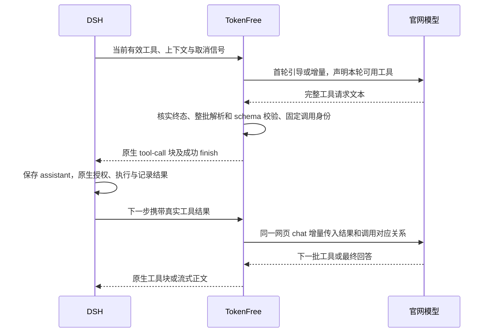

# 工具调用规格

实施更新：第一阶段主链已授权并写入源码，本地离线验证通过；实际范围及手测见 [主链说明](MAIN_CHAIN.md)。下文保留已确认行为与早期差距分析，不能将“当前 MVP”诊断当作新版本实现状态。

2026-10-21。工具调用与工具变更方案已由用户确认，尚未实现。首发继续使用网页文本协议表达调用意图，由插件转换成 DSH 原生工具块，权限、授权、调度、执行及结果全部由 DSH 管理。完整状态与剩余取舍见 [规格确认汇总](SPEC_STATUS.md)；本轮明确先不实现。

官网的搜索、打开网页等内部工具不属于这个调用通道。网页协议没有已确认的自定义 function calling 字段，插件也不在浏览器中执行本地命令。

## 一次完整调用



插件只有“生成与转交工具请求”的职责，不能直接调用工具 registry.execute、shell、MCP 或文件写入接口来绕过 DSH。只有原生执行结果能说明工具实际做了什么。

## 本轮工具目录

- 使用 DSH LlmRuntime 最终交给适配器的 options.tools 为输入，应用用户已确认的 TokenFree 搜索排除策略后形成实际声明：内置 web_search 不声明、不派发，也不在原生执行层运行；该例外及投影差异必须可追踪，不能仅靠提示词。不硬编码其他 read/write/bash，不把所有已安装插件的工具暴露出来。名称、描述和 parameters 原样保留，不猜别名、缩写或大小写。
- 首次导入完整当前目录；后续只发送目录新增、移除与定义变化，并带目录版本。旧网页历史中出现过的名称不构成本轮授权，工具移除立即失效。
- 首发使用 DSH 对不声明原生 toolUpdate 能力的适配器提供的“当前完整声明”投影，再由插件做文本增量；不自行把 deferLoading 声明并入允许列表。历史 toolHistory 只帮助还原定义变化，不与当前工具取并集。
- 如果 DSH 以后启用原生 deferred/in-history 模式，需要专门按声明与激活时间线接入；不能只看到历史 schema 就视为当前可调用。当前模式不会宣称实现服务端的原生延迟加载。
- DSH 若仅允许 run_code 等外层工具，就只发该工具；其嵌套工具由 DSH 自己管理，不能把嵌套名称提升为可直接调用工具。MCP 或其他插件工具也以 DSH 本轮实际声明为准。
- 固定本次生成使用的工具名称和 schema 摘要；等待期间注册或权限变化，仍由原生执行层再次裁决。插件的预校验通过不意味着权限已获批准。

### 工具目录发生变化

每次正常模型请求都比较两份内容：DSH 此次实际交付的完整工具快照，以及当前已确认网页父消息所关联的工具目录。按名称逐项比较 description、parameters 和声明属性；不能只比较工具数量、名称集合或监听 tool-addition。DSH 原生按名称生成增删消息，同名工具定义变化需要插件自己从完整快照识别。

| 变化 | 发给官网的增量 | 本地约束 |
| --- | --- | --- |
| 新增 | upsert 中包含名称、完整描述和完整 schema | 新请求才可使用；不从旧请求中补执行 |
| 删除 | remove 名称列表，并明确当前不可用 | 旧网页历史里的定义不再授权调用；历史调用和结果保留 |
| 同名描述、参数或约束变化 | upsert 该工具的完整新定义，替换旧定义 | 不做 schema 局部补丁，不让模型猜哪些字段失效；旧候选不套新定义执行 |
| 重命名 | 删除旧名并新增新名 | 不自动将旧名映射到新名，历史 callId 仍对应原调用 |
| 权限、审批或沙箱策略变化 | 若改变模型可见声明则同步目录，否则不伪造 schema 变更 | 原生执行时重新裁决，旧批准不由 TokenFree 复用 |

增量与新增用户消息、真实工具结果放在同一次 prompt 中，先声明目录变更，再提供本次输入，不另发一轮模型请求“确认工具”，也不因普通工具变更创建新 chat。每个工具 schema 使用规范化内容摘要，忽略对象键序导致的假变化；仅工具排列变化不重传全部定义。

目录状态带 fromVersion、toVersion 与内容摘要，并与账号、DSH session、网页 chat 和已确认父消息关联；不是所有会话共享一个全局工具版本。只有该分支实际包含已接受更新时才可作为后续基线，不能在排队或写入日志时就标为同步成功。提交状态不明时先核实请求，恢复同一响应继续使用它原来的目录；不能边 resume 边把工具候选改按新目录解释。

压缩后的新 chat 首次导入当前完整目录；DSH 重启后从确认游标与版本恢复。只缺目录快照但分支和原请求状态可确认时，可在同 chat 的下一次输入中重发完整当前目录作为显式替换，不重放整段聊天。分支或请求状态也不明时暂停核实，不能只重发目录掩盖关联错误。新增或修改的 schema 不支持时，在发出更新前报错；不把目录悄悄删减后继续。

### 生成中与执行前的变化

已提交给官网的 prompt 不能热更新。生成时固定本次目录；tools/change 只作为重新检查的通知，不直接把全局 registry 的所有定义推给官网。正常新增不打断当前正文，下一次模型请求同步新目录。

对即将交付的工具候选检查取消、账号代次和已知目录变更。已知被删除或定义不一致的调用不交付；没有受影响的正常候选可以继续。进入 DSH 后，原生仍在执行时解析当前工具、权限和参数。

为避免同名工具在等待授权期间更换参数定义，已通过公开 tools.guard 在原生执行前比较该 TokenFree callId 已固定的定义与当前可见定义，不一致则只拒绝，不批准或改写调用。工具已经进入执行时不因目录更新自动重跑、回滚或换工具；正常取消及结果由 DSH 管理。该检查不宣称与插件热更新具有跨进程原子事务，也不保证能识别可见定义未变但实现语义改变的第三方插件更新。

定义失效显示“工具已变化，本次调用未执行”；拒绝发生在原生层时保存并回传真实错误，后续模型步骤同步新目录。插件不自动换名、补参数或重放有副作用的操作。单纯业务参数报错仍遵守既定规则，不借目录更新放宽校验。

## 响应协议

普通正文和工具请求采用互斥分支。模型按 kind、protocol、request_id、text、calls 的顺序输出；字段顺序有助于正文流式，完整解析仍按 JSON 对象语义处理。

```json
{
  "kind": "tool",
  "protocol": "tokenfree/1",
  "request_id": "本次生成关联值",
  "text": "我先读取这个文件。",
  "calls": [
    { "name": "read", "arguments": { "file_path": "README.md" } }
  ]
}
```

示例名称和参数仅用于说明；实际 prompt 按当前 DSH 声明提供。text 可省略，不能包含自称已完成的工具结果。每个调用只允许 name 与 arguments；arguments 必须是 JSON 对象，不能是包着 JSON 的字符串、XML 或代码块。

最终回答为同版本、同 request_id 的 `kind=final` 与 text，不带 calls。用户明确需要 JSON/schema 最终结果时仍使用 final 分支，按已确认的结构化输出规格校验 text 内容。

协议关联值在网页 prompt 中可见，仅用于排除串流、错误分支或过期响应，不是授权密钥，也不保证能阻止提示注入。工具权限依赖 DSH 的执行边界。

## 批次校验与交付

整个工具响应缓冲到官网响应结束并核实成功后，按以下顺序处理，全部通过后才交付任何可执行块：

1. **终态**：核实当前 chat/response 身份、无撤回或过滤、没有断流未决状态；单独的 HTTP 200、finish 事件或连接关闭不足以通过。
2. **协议**：只接受一个根对象，无多段对象、尾随内容、重复键或未声明的协议字段；kind、版本、request_id 一致。不从普通回答、示例代码、思考或搜索片段中抽取工具 JSON。
3. **批次**：calls 长度为 1–8；不截取前 8 个继续执行。一次响应中任意一项失败，整批不交付。
4. **名称与参数**：名称精确匹配本轮允许列表；arguments 按该名称的 schema 校验 required、类型、数组、enum、oneOf 及 additionalProperties 等约束。schema 允许额外属性时不额外禁止；schema 禁止时不静默删除。
5. **本地策略**：核对禁用、下一次必须使用工具或指定工具等策略，以及本次请求用途。compaction、session-title 即使带了历史工具定义，也不允许交付调用。
6. **状态**：固定接受后的批次与调用 ID，持久化候选摘要；交付前再次检查取消、退出与账号代次。转换为原生 tool-call 块，完整结束后由 DSH 保存并进入执行层。

预校验优先复用 @deepseek-ai/dsh-tools 公开的 assertSupportedJsonSchema / validateJsonSchemaValue，保持与原生工具参数语义一致，不调用工具 execute 来“验证”。当前真实样本的 32 个声明都是 object 根，包含基本类型、数组、enum 和 oneOf；这只是兼容范围的源码依据，完整 schema 验收仍需实现时完成。

首发按原生校验器支持的子集执行；超出子集的第三方 schema 在生成前明确指出不支持的工具与字段，不静默删掉工具、不跳过约束，也不改成只做“参数是对象”的弱校验。若要扩展通用 JSON Schema 方言另行设计；工具校验不为此额外引入第二套规则。此前工具参数统一使用 Ajv 的提议由本方案替代；独立的最终 JSON/schema 能力不受此决定扩大或缩小。

不做字符串转数字、不填默认参数、不补文件路径、不改写 shell 命令，不远程加载 schema 引用。路径存在性、命令语义、沙箱及工具自身额外约束仍由原生执行检查，插件不会声称 schema 校验覆盖了这些条件。

协议文本与参数有明确的单响应字符/字节保护上限，沿用已确认的有界缓冲；不通过 token 估算制定或报告上限。超过上限直接停止该次响应并报错，不能裁剪 write.content、edit 参数或截断 JSON 后执行。

## 顺序、并发与权限

每次模型响应最多 8 个调用，这是单批限制，不是整轮任务只能使用 8 个工具。多个步骤及任务时限继续由 DSH 控制，不额外建立无限循环或自动重启任务。

模型被明确告知：**只有互不依赖的调用才能放在同一批次。** 例如先读文件，再根据内容编辑，必须先等 read 的真实结果，再提交 edit；不能假设同批第 2 个工具可以读取第 1 个工具的输出。多个独立读取可以同批。

DSH 调度器依据工具实际 executionMode、独占屏障和并行上限决定执行方式，并按模型顺序保存结果。插件不新增执行队列、不提高并发，也不宣称调用数组顺序就是执行开始或结束顺序。

用户确认、拒绝、沙箱、工具内部权限与已有审批行为全部沿用 DSH；插件不会为每次工具请求再加一个确认框，也不会自动批准 DSH 的询问。等待授权时显示原生状态，不占用网页生成锁；取消、拒绝或超时遵循原生结果和流程。

## 工具身份与真实结果回传

模型不生成 DSH callId。插件从本地操作身份、接受的响应身份与批次序号稳定派生 `tokenfree_…` ID，映射在交付前固定。每个序号独立，即使两个调用参数完全相同也不能擅自合并；后续用户有意再次运行相同参数仍是新的调用。

DSH 结果只有 callId，需要从此前已接受调用找回工具名和映射。下一步使用同一网页 chat、接在已确认的网页响应后，仅追加 DSH 实际提供的结果及必要更新：

```json
{
  "kind": "tool_results",
  "results": [
    {
      "response_id": 42,
      "call_index": 0,
      "call_id": "tokenfree_稳定身份",
      "name": "read",
      "isError": false,
      "content": [{ "type": "text", "text": "DSH 实际返回的内容" }]
    }
  ]
}
```

该示例是增量 prompt 内的数据，不是另一个官方 API。isError 以 DSH 值为准：true、显式 false 与缺省保留区别，不能把缺省默认成成功。只传入模型可见 content，不将 diff 展示 meta、审批私有详情或 error.reason 等非模型内容擅自加入 prompt。

DSH 给出的成功、错误、拒绝、取消结果照实回传，不由插件捏造；后续由模型根据真实结果继续任务。插件不自动重试可能有副作用的工具。原生调度若取消未启动调用并生成配对错误结果，同样按原生事实处理，不能说工具已执行。

如果原生工具结束当前回合，例如某种用户交互或结论工具，不强行发起下一次网页生成；后续何时继续由 DSH 决定。任务内的用户提问与授权使用 DSH 原生界面，插件不替用户回答。

DSH 已剪裁或卸载的模型可见结果按原生投影回传，并保留可用的截断/文件句柄标识，不从工具私有日志补回被裁去内容。图片和文件交给 DSH LlmRuntime 已有的文本模型投影：附件转实际可读句柄、图片有诚实占位；不声称模型看过图片。仍有无法表达的非文本块时明确报不支持，不能丢掉一部分并假装完整，也不能因此重执行已经完成的工具。

## 异常、修正与防重复

| 情况 | 行为 |
| --- | --- |
| 普通 final 中出现工具示例或模型自称执行成功 | 作为文本，不派发工具；执行状态仍只来自原生事件 |
| 未知工具、非法参数、策略不满足 | 整批不交付，显示错误与调用序号/字段路径；不自动猜测或改写 |
| 额外协议字段、重复键、响应身份不一致 | 不派发；身份异常先核实，不以格式修正绕过 |
| 截断工具 JSON、异常终态或网络中断 | 不派发，优先恢复同一响应；不能拿半个候选做格式修正或新请求重放 |
| 完整终态但仅外壳不合规 | 在既有流式约束允许时，最多做一次格式修正；若涉及工具，只有能无歧义提取已存在的完整名称与参数才允许修正，且修正前后语义必须一致 |
| 工具候选无法无歧义还原 | 直接失败；不能让修正模型补全被截断参数、增添新调用或重新规划来获得执行权限 |
| 原生拒绝、运行报错或用户取消 | 保存并回传真实结果；插件不自行重试。用户后续修改权限或要求重试时才是新操作 |
| 一批执行到一半失败或停止 | 尊重已发生副作用；不回滚、不宣称批次事务。只把实际已确认的结果交给后续模型 |

格式修正与普通生成一样可用官网额度，记录为独立网页响应，仍在当前 chat；没有结果交付前才允许自动修正。有效工具响应的请求关联、名字、参数、顺序和数量都必须保持，不能通过“修正”增加权限。修正后重新执行所有校验。

原响应与修正响应是同一 operationId 的 original/repair 两步，不是两个 DSH 模型尝试。repair 以原响应为父消息；只有修正结果完整校验且由 DSH 保存、刷盘后，repair 响应才成为正常续聊父消息。原候选不单独交付；修正仍不改变目录、意图或一次性工具策略。不能再用“所有辅助响应都不推进主链”排除这条已接受修正。终态明确的最终失败标记下次按有效历史重建；不明状态先核实。状态与提交定义统一见 [技术方案](TECHNICAL_DESIGN.md#4-p1-2正文停止与修正的上下文归属)。

恢复同一个网页 response 时保持同一批次 ID。原生 assistant 保存之前、之后以及工具实际执行是不同阶段：插件日志记录“已解析/已交付”，只有 DSH 事件才能证明“已保存/已执行”。按 DSH 已保存消息、tool/call、tool/result 与本地 pending 共同核对。发现已经交付或派发的身份不自动再发；无法确定的崩溃窗口暂停并提供核实入口，不宣称跨进程绝对 exactly-once。

## 工具选择策略

首发默认 auto：模型可以回答或请求工具。高级设置可提供如下有限策略，执行权限仍由 DSH 处理：

2026-10-23 已通过现有本地会话记录、CLI 和 owner Remote 实现，示例见 [会话设置](POLICIES.md)；单张卡片不新增控件。模拟及原生 SDK 组合的验证见 [验证记录](VALIDATION.md)，不将其记为新的真实账号验收。

| 策略 | 具体范围 |
| --- | --- |
| auto | 当前会话持续生效，使用本轮 DSH 声明 |
| 禁用工具 | 当前会话持续生效，提示无工具且拒绝任何工具分支 |
| 下一次必须使用工具 | 只约束下一次正常对话生成；接受并由 DSH 保存合规批次后消耗，不要求最后答案也调用工具 |
| 下一次指定工具 | 同上，且该批次只能使用指定的当前可用工具；不存在时生成前报错 |

断流恢复与格式修正不消耗“一次”策略，compaction 和 session-title 不消耗该策略；错误和取消保留待执行状态，用户可以解除。既定批次已在 DSH 保存但执行被拒绝时，一次策略已被消费，不反复强迫模型申请同一权限。

## 验收门槛

| 编号 | 必须证明的行为 |
| --- | --- |
| T1 | 按原生声明驱动目录；增删、重命名、同名描述/schema 修改和纯排序可区分；不额外建 chat；恢复基线正确，旧历史不能恢复权限；执行前变更会拒绝，run_code 等外层工具不被绕过 |
| T2 | read/glob/grep、write/edit、实际声明的命令工具可完成多步骤任务，结果准确配对；依赖步骤等待前序结果 |
| T3 | required/type/enum/oneOf/额外字段等校验一致；不支持 schema 提前报错，无类型强转、补参或静默跳过 |
| T4 | 任一非法或第 9 个调用使整批不交付；普通文本中的工具示例不执行 |
| T5 | DSH 原生授权、拒绝、取消、工具报错和结束回合行为保持；没有插件额外审批或执行旁路 |
| T6 | isError true/false/缺省及 content/句柄/截断标记保留，私有 meta 不流入 prompt；图片不冒充已读 |
| T7 | ready 前后断流、重复快照、恢复完成、停止和崩溃窗口不自动重复派发；不确定时停下 |
| T8 | 格式修正最多一次且不改变工具意图；不完整候选不修补后执行；已显示正文后不自动修正 |
| T9 | 辅助用途绝不派发工具；一批多个独立调用仍遵守 DSH 的并发/独占/结果排序 |
| T10 | 工具准备状态、原生工具卡、真实执行结果与诊断关联可追踪；流式 S4–S7 继续满足 |

模拟测试负责确定性协议与竞态；真实文件、命令、用户交互与权限由用户手动验收，研发读取原生日志核对。没有通过对应 schema/结果类型验收的第三方工具不列为已兼容。

源码依据：[当前编码与 isError 缺口](src/core/codec.ts#L29)、DSH 工具声明投影（`DSH packages/llm/llm/src/index.ts:1096`）、声明更新模式（`DSH packages/llm/llm/src/content.ts:424`）、公开 schema 校验（`DSH packages/core/tools/src/index.ts:91`）、原生执行前门控（`DSH packages/core/tools/src/index.ts:1504`）、调度与结果保存（`DSH packages/core/agent-loop/src/tool-calls.ts`）、先保存 assistant 再执行工具（`DSH packages/core/agent-loop/src/agent.ts:537`）。
